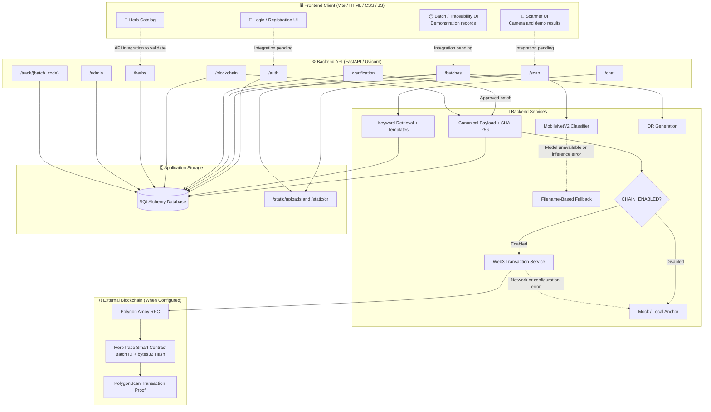

# 🏛️ Farm2Ayur — System Architecture Document

> **"From Soil to Synergy"** — Technical architecture, component design, data layer, AI services, and cryptographic provenance model for the Farm2Ayur platform.

---

### 📋 System Metadata

| Attribute | Details | Attribute | Details |
| :--- | :--- | :--- | :--- |
| **System Name** | **Farm2Ayur** | **Current Stage** | 🟡 Active Prototype |
| **Architecture** | Decoupled web frontend and REST API | **Backend API** | FastAPI (Python) · Uvicorn |
| **Frontend** | Vite · HTML5 / CSS3 / JavaScript ES Modules | **Database** | SQLAlchemy · SQLite or PostgreSQL via `DATABASE_URL` |
| **AI Vision Engine** | MobileNetV2 (`farm2ayur-v9`, 5 classes) with filename-based fallback | **Traceability** | SHA-256 ledger with optional real blockchain anchoring on Polygon Amoy |

> **Implementation status:** Backend APIs and the HerbTrace smart-contract integration are available, and blockchain anchoring has been demonstrated on Polygon Amoy. The frontend scanner and traceability views still contain demonstration data and require end-to-end API integration.

---

## 1. System Overview

**Farm2Ayur** is a prototype for medicinal-plant identification, batch verification, and supply-chain traceability for the Ayurvedic ecosystem.

The system is organized into these logical components:

- **Frontend Client:** A Vite-based web application containing plant-scanner, herb-catalog, authentication, and batch-traceability views. Some views currently use local demonstration data.
- **Backend API:** A FastAPI REST service with routers, SQLAlchemy models, Pydantic schemas, and role-protected operations.
- **AI Identification Service:** A MobileNetV2 classifier for five plant classes. If the model is unavailable or inference fails, the backend falls back to matching the uploaded filename against herb records. This fallback does not visually identify a plant.
- **Ayurvedic Knowledge Service:** Database-backed keyword retrieval and template-based response assembly using herb records and verified knowledge documents.
- **Traceability Service:** Creates canonical batch snapshots, calculates SHA-256 hashes, maintains database-backed hash-chain records, and can register a batch identifier and hash through the HerbTrace smart contract when real-chain mode is configured.
- **Persistence and File Storage:** SQLAlchemy-managed relational data and local static storage for uploaded images and QR assets.

The complete frontend-to-API journey remains an integration task. The architecture below distinguishes implemented backend capabilities from frontend connections that still require completion.

---

## 2. Architecture Diagram



### Reading the Diagram

- **Solid arrows** represent backend processing or blockchain interactions.
- **Dashed arrows from the frontend** identify connections that remain to be verified or integrated; they do not imply that the UI already calls those APIs.
- **Mock/local mode** creates a database record with a synthetic transaction-like identifier. It does not broadcast a transaction to Polygon.
- **Real-chain mode** uses Web3 and the configured RPC endpoint to register the batch identifier and SHA-256 hash in the HerbTrace contract.
- The blockchain stores the identifier and hash, not the full batch payload.

---

## 3. Frontend Architecture

The frontend is a Vite-based web application using HTML, CSS, and JavaScript ES modules.

### Main Views and Current Behaviour

- `index.html` and `public/runtime/app.js`: Main portal, catalog, supply-chain views, navigation, and locally defined demonstration herb and batch data.
- `scan.html` and `scan.js`: Camera and drag-and-drop scanner interface with hardcoded sample herb results. The inspected scanner file does not submit images to the FastAPI `/scan` endpoint.
- `public/runtime/traceability.js`: Contains demonstration traceability records, stage details, and hash-like display values. These are presentation data, not proof of live API records or blockchain transactions.
- `login.html` and `script.js`: Login and registration interface. The inspected `script.js` handles the login-panel toggle; complete authentication integration must be verified across the relevant runtime modules.
- `about.html`: Platform and developer information.

### Frontend-to-Backend Integration Status

Backend APIs are available, but the inspected scanner and traceability files do not call them through `fetch()` or an equivalent HTTP client.

The integration phase should connect authentication, plant-image uploads, herb information, batch verification, and public traceability to the backend API. Demonstration data should then be replaced with live data or clearly identified as sample data.

---

## 4. Backend & APIs

The backend uses **FastAPI** and **Uvicorn**, with separate routers, services, schemas, and SQLAlchemy models.

The following table summarizes the inspected backend routes. Access controls should be rechecked before production deployment.

| Router / Route | Access as Implemented | Key Responsibilities |
| :--- | :--- | :--- |
| `auth` — `/auth` | Registration and login routes; route-specific rules apply | User registration, login, JWT issuance, and profile operations. |
| `herbs` — `/herbs` | Public catalog routes | Herb records and botanical information. |
| `batches` — `/batches` | Role-protected, route-specific | Batch creation, batch details, status operations, and QR-related data. |
| `scan` — `/scan` | Authenticated | Image upload, AI identification, and scan-history storage. |
| `verification` — `/verification` | Creating decisions requires verifier/admin roles; other routes have route-specific dependencies | Verification records, batch approval/rejection decisions, and automatic anchoring attempts after approval. |
| `blockchain` — `/blockchain` | `POST /anchor` requires collector/verifier/admin roles; GET routes in this router do not declare authentication dependencies | Create anchor records, list records, transaction lookup, local ledger verification, and on-chain hash verification. |
| `chat` — `/chat` | Authenticated | Database-backed Ayurvedic knowledge lookup and assistant responses. |
| `uploads` — `/uploads` | Route-specific upload access | Uploads such as botanical images and COA documents. |
| `admin` — `/admin` | Admin-protected routes | Administrative views and user-management functions. |
| `track` — `/track/{batch_code}` | Public in `main.py` | Returns batch details for public tracking. |

### Blockchain Endpoint Distinction

- `GET /blockchain/verify/{batch_id}` and `GET /blockchain/verify/code/{batch_code}` validate records in the **local database-backed ledger**.
- `GET /blockchain/verify-chain/{batch_id}` and `GET /blockchain/verify-chain/code/{batch_code}` attempt to read the HerbTrace contract and compare its stored hash with a hash rebuilt from current batch data.
- A `mock-anchored` response means the batch has only a local mock record. It is not an on-chain confirmation.
- The inspected blockchain router does not declare authentication dependencies on its GET routes. Review whether these endpoints should be restricted or rate-limited before production use.

---

## 5. Database & Data Layer

Persistence is managed using SQLAlchemy. `DATABASE_URL` is required by `backend/app/database.py` and determines which database is configured. The code supports SQLite-specific connection settings and PostgreSQL JSONB handling.

| Domain | Model / Table Area | Purpose |
| :--- | :--- | :--- |
| **Users & Access** | `users` | User identity, password hash, role, and organization-related information. |
| **Botanical Data** | `herbs` and related herb tables | Botanical names, synonyms, taxonomy, habitat, traditional-use information, and safety records. |
| **Supply Chain** | `batches`, `batch_events` | Batch code, herb and collector references, harvest/location data, quantity, status, and event history. |
| **Verification** | `verification_records` | Target, decision, verifier, confidence/comments, and supporting evidence references. |
| **Provenance** | `blockchain_records` | Batch snapshot payload, SHA-256 hash, previous hash, network, transaction hash, wallet address, status, and notes. |
| **AI & Knowledge** | AI scan and knowledge/chat models | Scan predictions and history, knowledge documents, and assistant-related records. |

The full batch payload remains in the application database. The contract stores a batch identifier and its `bytes32` data hash.

Files are stored under the backend's static upload and QR directories unless deployment configuration changes that behaviour.

---

## 6. AI/ML and Ayurvedic Knowledge Integration

### AI Plant Identification (`backend/app/services/ai_identifier.py`)

- **Model:** The service attempts to load `farm2ayur_v9_best.keras` from the backend ML directory.
- **Target Classes:** Amla, Ashwagandha, Guduchi, Neem, and Tulsi.
- **Image Preprocessing:** Converts the image to RGB, resizes it to 224 × 224 pixels, and creates a batch tensor for inference.
- **Confidence Threshold:** Predictions below `0.55` are marked `low_confidence`.
- **Fallback:** If the model file is missing, the model cannot load, or inference throws an error, the service matches the original filename against herb names in the database.

This fallback is a metadata heuristic, not visual AI inference. It must not be represented as equivalent to model-based recognition.

The separate frontend scanner currently displays a hardcoded demonstration knowledge base containing a different set of sample plants. It should be connected to the backend service and aligned with the supported model classes before it is presented as an end-to-end AI feature.

### Ayurvedic Knowledge Assistant (`backend/app/services/rag_engine.py`)

- **Retrieval:** Checks herb names and verified knowledge-document content using keyword and substring matching.
- **Response Assembly:** Produces template-based text using available database fields such as botanical names, traditional-use information, habitats, and safety notes.
- **Disclaimer:** Adds an educational and medical disclaimer to responses.

The inspected implementation does not use a vector database, embedding retrieval, or an external generative language model. It should therefore be described as a database-backed keyword-retrieval and response-assembly service unless these components are implemented later.

---

## 7. Blockchain and Traceability

Farm2Ayur has **two distinct traceability modes**: a local/mock path and an optional real-chain path. The local path remains useful during development, but it must not be confused with a transaction confirmed on Polygon.

### 7.1 Batch Approval and Anchor Flow

1. A verifier or admin submits an approval decision for a batch through `POST /verification/`.
2. The backend saves the verification decision and adds a verification event to the batch.
3. For an approved batch, the backend attempts to anchor a snapshot unless an existing on-chain anchor is detected.
4. The traceability service creates a canonical payload from batch fields and the events included at anchor time.
5. A SHA-256 digest is calculated over the canonical JSON payload.
6. If real-chain configuration is enabled, Web3 simulates the contract call, builds and signs a transaction, broadcasts it, and waits for a transaction receipt.
7. The database stores the snapshot, hash, network label, transaction hash, wallet address, status, and notes.

If the anchor attempt fails, the verification decision remains saved and the API response reports the anchoring failure. Check `blockchain_status` and the network fields instead of assuming that approval always means an on-chain transaction succeeded.

### 7.2 Canonical Payload and SHA-256 Hash

The backend serializes the snapshot as deterministic JSON using sorted keys and compact separators, then calculates SHA-256:

```text
data_hash = SHA-256(canonical_json_payload)
```

The payload includes core batch data, events present at anchor time, and anchor metadata. The digest is represented as a 64-character hexadecimal string locally and converted to 32 bytes for the contract call.

### 7.3 Local Hash-Chain Ledger

The `blockchain_records` table stores each local record's `data_hash` and `previous_hash`. For a batch, the next record references the prior record's hash.

Local ledger verification recalculates each payload hash and checks the previous-hash links.

This provides tamper evidence for the records being checked, but a database-backed hash chain is not, by itself, a decentralized blockchain. A party with sufficient database control could alter both the data and local records. Anchoring to a smart contract provides an independent reference when a real transaction has been confirmed.

### 7.4 Real HerbTrace Contract Integration

When `CHAIN_ENABLED` is enabled and required configuration is present, the backend connects to the configured RPC and calls the HerbTrace contract's `registerBatch(batch_code, data_hash)` function.

The contract stores the batch identifier, hash, registering wallet, and timestamp. It does not store the full batch JSON.

**Known Testnet Deployment**

- **Network:** Polygon Amoy
- **Chain ID:** `80002`
- **Contract:** [`0x69ce77ef7Fb9AbC100D5FAd402EC24E87434bC6b`](https://amoy.polygonscan.com/address/0x69ce77ef7Fb9AbC100D5FAd402EC24E87434bC6b)
- **Example successful registration transaction:** [View on PolygonScan](https://amoy.polygonscan.com/tx/0xaaf79278cd3343d0145b45967e6e716a5abf965bdf8b1a3cb8e929323ff11cd3)

These links document a testnet demonstration. They do not represent a production deployment.

### 7.5 Mock Mode and Fallback Behaviour

- If `CHAIN_ENABLED` is false, the service creates a local mock record.
- If real-chain broadcasting encounters certain RPC, network, or configuration errors, the service logs the failure and falls back to a mock record.
- Contract reverts are re-raised rather than treated as successful contract registrations.
- Mock records use the network label `mock-chain` and a placeholder wallet value. They do not have a confirmed Polygon block number.
- **A response status of `anchored` alone is insufficient to prove on-chain anchoring.** Check the network label, transaction hash, block/receipt details, and explorer evidence.

A real Amoy record is expected to carry `chain-id-80002` in the network field.

Fallback is convenient during development, but it can mask configuration problems if callers ignore the returned network. For demonstrations, make the operating mode explicit and verify real transactions in PolygonScan.

### 7.6 Verification Paths

| Endpoint | What It Checks |
| :--- | :--- |
| `GET /blockchain/verify/{batch_id}` | Recalculates hashes for local database-backed records and checks previous-hash links. |
| `GET /blockchain/verify/code/{batch_code}` | Performs the same local-ledger checks, selected by batch code. |
| `GET /blockchain/verify-chain/{batch_id}` | Reads the contract when configured and compares the stored on-chain hash with a hash rebuilt from current batch data. |
| `GET /blockchain/verify-chain/code/{batch_code}` | Performs the same on-chain comparison, selected by batch code. |

The on-chain verification path can report:

- `verified`: The rebuilt current hash matches the hash stored in the contract.
- `modified-since-anchor`: The rebuilt current hash differs from the on-chain hash.
- `mock-anchored`: Only a mock/local anchor record is available; no matching contract record was found.
- `not-anchored`: No contract anchor or local mock anchor was found.

The verification logic preserves anchored snapshot metadata and compares events that existed at anchor time. Later events can be counted separately rather than automatically treated as edits to an older event.

This logic detects changes relative to the stored anchor; it does not prove that the original submitted real-world information was truthful.

### 7.7 Configuration and Key Handling

The real-chain integration reads these environment variables:

| Variable | Purpose |
| :--- | :--- |
| `CHAIN_ENABLED` | Enables real-chain mode when set to a truthy value. |
| `CHAIN_RPC_URL` | RPC endpoint. The code has a local-node default, so set this explicitly for Polygon Amoy. |
| `CONTRACT_ADDRESS` | Deployed HerbTrace contract address. |
| `CHAIN_PRIVATE_KEY` | Private key for the wallet that submits contract transactions. |

Keep actual values in a local, untracked environment file or secret manager. Never commit the private key, keystore files, or other credentials. Use a test wallet with limited testnet funds for the Amoy demonstration.

### 7.8 Current Limitations

- Polygon Amoy is a test network, not a production network.
- The complete frontend-to-backend user journey is not yet integrated.
- Mock fallback can create an `anchored` local record when real-chain configuration or network access fails. Callers must inspect the network and transaction information.
- Contract registration is write-once for a batch identifier; anchoring a changed snapshot under the same identifier may be rejected by the contract.
- RPC availability, wallet funds, network fees, contract ownership, ABI/address consistency, and environment configuration affect real-chain operations.
- A hash match verifies consistency with an anchored snapshot, not the scientific quality, source authenticity, or truthfulness of the original batch data.

---

## 8. Validation and Demonstration Evidence

The blockchain integration has been demonstrated manually on Polygon Amoy: a test batch was registered, its transaction was visible in PolygonScan, and the backend's on-chain verification returned a matching hash for the anchored data.

Previously reported development testing included Hardhat contract tests and backend pytest tests. Re-run the test suites on the current checkout before relying on a specific test count in a formal submission.

### Demonstration Procedure

1. Start the backend with the intended database configuration and environment variables.
2. Open `http://127.0.0.1:8000/docs`.
3. Create a batch and submit an approval verification.
4. Check the response's `blockchain_status`, `anchor_note`, network, and transaction hash.
5. For real-chain mode, open the transaction in PolygonScan and confirm that it succeeded.
6. Call the matching `/blockchain/verify-chain/...` endpoint and confirm its status and hash values.

Do not perform a tamper demonstration against shared or important data without a backup. Use a disposable test batch and database when testing record modification.

---

## 9. Repository Locations

| Component | Main Code Location |
| :--- | :--- |
| FastAPI application and route registration | `backend/app/main.py` |
| Database setup | `backend/app/database.py` |
| AI plant identification | `backend/app/services/ai_identifier.py` |
| Ayurvedic knowledge retrieval | `backend/app/services/rag_engine.py` |
| Blockchain hashing, broadcast, and verification | `backend/app/services/blockchain.py` |
| Blockchain API endpoints | `backend/app/routers/blockchain.py` |
| Automatic anchoring after approval | `backend/app/routers/verification.py` |
| Blockchain model and schemas | `backend/app/models/blockchain.py`, `backend/app/schemas/blockchain.py` |
| Frontend scanner demo | `scan.html`, `scan.js` |
| Main frontend demo/catalog | `index.html`, `public/runtime/app.js` |
| Frontend traceability demo records | `public/runtime/traceability.js` |
| Separate Solidity/Hardhat contract project | `HerbTrace-Full` (maintained separately) |

---

## 10. Next Architecture Milestones

1. **Frontend/API Integration:** Replace or clearly separate hardcoded demo data and connect scanner, authentication, herb catalog, batch, and traceability views to the actual FastAPI endpoints.
2. **Maps and Location Module:** Define the mapping provider, permissions, location data flow, and error states before representing the module as implemented.
3. **AI Certification:** Specify the evidence, verification rules, decision authority, and data persisted for certification. Do not equate model confidence with certification.
4. **Operational Hardening:** Review authentication on read endpoints, make real-chain versus mock mode prominent in API responses and UI, and validate deployment secrets and monitoring.
5. **End-to-End Verification:** Test the complete browser → API → database → Polygon Amoy path, including rejected batches, RPC failures, duplicate anchors, and data changes after anchoring.

---

**Document Intent:** This document describes the current prototype and explicitly identifies work that remains. Update it whenever routes, frontend connections, model behaviour, or blockchain configuration changes.
