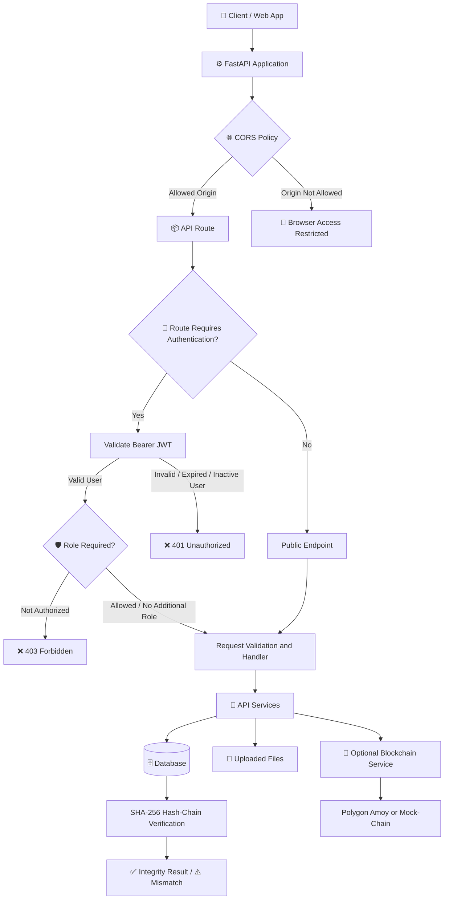

# 🛡️ Farm2Ayur — Security Architecture & Specification

> **"From Soil to Synergy"** — Security posture, access control architecture, data protection controls, and cryptographic integrity verification for the Farm2Ayur platform.

---

### 📋 Security Metadata

-059669?style=for-the-badge&logo=jsonwebtokens)

-yellow?style=for-the-badge)

| Attribute | Details | Attribute | Details |
| :--- | :--- | :--- | :--- |
| **System Name** | **Farm2Ayur** | **Security Baseline** | Security controls reviewed against common OWASP API risks |
| **Backend Framework** | FastAPI · Python · Uvicorn | **Authentication** | JWT Bearer Tokens / HS256 |
| **Password Storage** | Salted bcrypt hashes | **Data Storage** | SQLite / PostgreSQL · SQLAlchemy |
| **Integrity Model** | SHA-256 Hash Chaining | **Blockchain Stage** | Polygon Amoy Testnet + Internal Mock-Chain Fallback |

---

## 1. Security Overview

Farm2Ayur manages herb batch information, verification decisions, uploaded documents, botanical records, and blockchain-related integrity references. Its security approach includes:

1. **Identity & Authorization:** JWT authentication and role-based restrictions on sensitive operations such as batch creation, verification decisions, and blockchain anchoring.
2. **Data Integrity & Provenance:** Deterministic SHA-256 hashing, a local hash-chain ledger, and optional public-testnet anchoring to help detect changes to recorded data.
3. **Botanical & Consumer Safety:** A configured plant-identification confidence threshold and an educational safety disclaimer for Ayurvedic assistant responses.
4. **Credential Protection:** Salted bcrypt password hashing and environment-based configuration for application secrets.
5. **API & File Security:** Request validation, a CORS allowlist, upload-extension checks, and generated filenames.
6. **Security Hardening:** Additional work remains for upload-size enforcement, content validation, public-data exposure, rate limiting, and production secret management.

**Scope note:** This document describes controls observed in the inspected code. It is not a penetration-test report or a certification of overall security.

---

## 2. High-Level Security Architecture

**Architecture note:** CORS is a browser cross-origin policy, not an authentication or authorization mechanism. Route-level access controls must independently protect restricted operations. Some routes are public by design, so the security boundary must be evaluated endpoint by endpoint.

---

## 3. Authentication and Authorization

### 3.1 JWT Authentication Pipeline (`app/utils/auth.py`)

- **Token Format:** JSON Web Tokens signed using the `HS256` symmetric algorithm.
- **Token Claims:** Tokens include the subject user ID, email, role, and expiration timestamp.
- **Token Lifespan:** Configured through `ACCESS_TOKEN_EXPIRE_MINUTES`, defaulting to 1440 minutes (24 hours).
- **Session Verification:** `get_current_user` decodes the token, retrieves the user from the database, and rejects missing, invalid, expired, or inactive accounts.
- **Authorization:** The `require_roles(*allowed_roles)` dependency checks the database user's current role for routes using that dependency.
- **Registration:** `POST /auth/register` assigns `role="user"` in the route, regardless of the role supplied in the request.

### 3.2 Role-Based Access Control (RBAC) Matrix

The application defines four roles: `user`, `collector`, `verifier`, and `admin`.

| Role Key | Description | Observed Operations & Endpoint Scopes |
| :--- | :--- | :--- |
| `user` | Public Consumer / Enthusiast | Authenticated plant scanning (`/scan/`), chat queries (`/chat/query`), and other authenticated routes permitted to general users. |
| `collector` | Herb Harvester / Field Worker | Create batches (`POST /batches/`), add lifecycle events, and request blockchain anchors. |
| `verifier` | Quality Analyst / Lab Verifier | Record verification decisions, update applicable batch statuses, add lifecycle events, and request blockchain anchors. |
| `admin` | Platform Administrator | Admin dashboard and management routes, herb management, user role management, and other explicitly authorized operations. |

### 3.3 Access-Control Considerations

- New registrations are created as ordinary `user` accounts. Privileged roles are available through the administrator role-management route.
- Authentication is not applied globally to every route; it is defined on individual endpoint handlers.
- Batch-code lookups, public tracking, QR downloads, herb-read endpoints, and several blockchain lookup or verification endpoints do not require authentication in the inspected code.
- Some verification-detail endpoints require only authentication rather than a verifier/admin role.
- Public responses and authenticated-user responses should expose only the information required for their purpose.

**Status:** JWT authentication and role-aware dependencies are implemented in the backend. Route-by-route authorization and data-exposure testing remain necessary.

---

## 4. Data Protection & Cryptography

### 4.1 Credential & Secret Management

- **Password Hashing:** Passwords are hashed using bcrypt with a generated salt.
- **Password Length Handling:** The current implementation truncates UTF-8 password bytes to 72 bytes before hashing and verification. This means distinct passwords sharing the same first 72 bytes may be treated as equivalent and should be addressed.
- **Password Validation:** The user schema requires a minimum password length of six characters. Stronger password requirements should be considered before production deployment.
- **Response Models:** The inspected user response schema exposes profile fields but does not include the stored password hash.
- **Secret Configuration:** `python-dotenv` loads environment configuration, while `SECRET_KEY` currently has a hardcoded fallback value.
- **Production Requirement:** A production startup must fail safely if a strong, unique `SECRET_KEY` has not been explicitly configured.

### 4.2 Database & Query Security (`app/database.py`)

- **ORM Usage:** The inspected routes use SQLAlchemy query expressions for database access.
- **Input Validation:** Pydantic request schemas provide type validation and selected field validators, including role, batch-event, and batch-status validation.
- **Database Configuration:** `DATABASE_URL` is required by the current database initialization code.
- **Database Permissions:** Production database access should follow least privilege, with restricted network exposure, protected credentials, and appropriate backups.

**Security limitation:** The use of an ORM and request schemas helps reduce common risks, but does not by itself prove that every query, input, or business rule is safe.

---

## 5. API and Application Security

| Security Control | Implementation Detail | Source File | Status |
| :--- | :--- | :--- | :---: |
| **Request Schema Validation** | Pydantic models validate request fields and selected allowed values. Coverage differs by schema. | `app/schemas/*.py` | 🟢 Implemented |
| **JWT Authentication** | Bearer-token validation and active-user checks on routes that declare authentication dependencies. | `app/utils/auth.py` | 🟢 Implemented |
| **Role Authorization** | `require_roles` restricts selected batch, verification, herb-management, and admin operations. | `app/utils/auth.py`, `app/routers/*.py` | 🟢 Implemented; audit required |
| **CORS Origin Allowlist** | Allows configured localhost development origins on ports 3000 and 5173. | `app/main.py` | 🟢 Development configuration |
| **Public Data Exposure** | Public tracking, batch-code lookup, QR download, and some verification/blockchain routes return data without authentication. | `app/main.py`, `app/routers/*.py` | 🟡 Review required |
| **Upload Extension Allowlist** | Upload endpoints check filename extensions against configured image/PDF extensions. | `app/routers/uploads.py` | 🟡 Partial |
| **Generated Upload Filenames** | UUID-based filenames reduce the risk of collisions and user-controlled path names. | `app/routers/uploads.py` | 🟢 Implemented |
| **File Size Enforcement** | A 10 MB constant exists, but active byte-limit enforcement is absent from the inspected upload handlers. | `app/routers/uploads.py` | 🔴 Not enforced |
| **Upload Content Validation** | Actual file content and magic-byte signatures are not checked in the inspected upload handlers. | `app/routers/uploads.py` | 🔴 Not implemented |
| **Static File Access Control** | The `/static` directory, including uploaded files, is mounted for public serving. | `app/main.py` | 🟡 Review required |
| **Rate Limiting** | No global or endpoint-specific rate-limiting middleware was found in the inspected application setup. | `app/main.py` | 🔴 Not observed |
| **Safe Error Responses** | Some exception handlers return exception text in HTTP responses. | `app/routers/uploads.py`, `app/routers/blockchain.py` | 🟡 Hardening required |
| **Production CORS Configuration** | The configured origins are development localhost values. Production origins must be configured explicitly. | `app/main.py` | 🟡 Deployment task |

### 5.1 Important API Exposure Notes

- `GET /track/{batch_code}` and `GET /batches/code/{batch_code}` return batch details that may contain location, collector-related, note, and event information.
- `GET /batches/{batch_id}/qr` is not protected by an authentication dependency in the inspected route.
- Blockchain record lookup and verification endpoints include public routes.
- Verification-detail routes allow any authenticated user where the handler uses `get_current_user` without an additional verifier/admin role check.
- The application must define which data is intentionally public, then redact or restrict the remaining fields accordingly.

---

## 6. AI and Botanical Data Safety

### 6.1 Plant Identification Safeguards (`app/services/ai_identifier.py`)

- **Confidence Threshold:** Predictions below `LOW_CONFIDENCE_THRESHOLD = 0.55` are returned with a `low_confidence` status when the model inference path is used.
- **Graceful Degradation:** If the model is unavailable or inference fails, the service falls back to filename-based herb-name matching.
- **Classification Scope:** The configured model classes are Amla, Ashwagandha, Guduchi, Neem, and Tulsi.
- **Result Limitation:** The configured class list does not establish reliable identification for unknown species or guarantee that a high-confidence prediction is correct.
- **Fallback Limitation:** Filename-based matching uses input metadata rather than visual evidence and must not be presented as visual AI recognition.
- **User Safety:** Plant predictions should be treated as assistance, not as a definitive determination for medicinal use, harvesting, or treatment.

### 6.2 Ayurvedic Knowledge & Assistant Guardrails (`app/services/rag_engine.py`)

- **Knowledge Document Filtering:** The inspected retrieval code filters knowledge documents to those marked `is_verified == True`.
- **Herb Database Records:** Herb matching is performed against available herb names; this path is not the same as verifying every retrieved herb record.
- **Response Construction:** The current service uses keyword/substring matching and templated responses rather than a demonstrated vector-embedding retrieval system or general-purpose generative model.
- **Safety Disclaimer:** Responses append an educational-use disclaimer recommending consultation with a qualified Ayurvedic physician or healthcare provider.
- **Limitations:** A disclaimer does not guarantee medical safety or prevent every incorrect, incomplete, or misunderstood response.
- **Future Hardening:** Improve source traceability, handle ambiguous queries explicitly, and evaluate protections against prompt-based manipulation if generative model capabilities are introduced.

---

## 7. Blockchain and Data Integrity

### 7.1 Local Hash-Chain Ledger (`app/services/blockchain.py`)

Farm2Ayur maintains local integrity records using deterministic JSON serialization and SHA-256 hashing.

1. **Deterministic Serialization:** Batch snapshot data is serialized using sorted keys and compact separators.
2. **SHA-256 Digest:** A digest is calculated from the canonical JSON byte sequence.
3. **Hash Linking:** New ledger records include the previous hash associated with that batch.
4. **Local Verification:** The `/blockchain/verify/{batch_id}` endpoint recalculates stored payload hashes and checks the expected previous-hash links.
5. **Integrity Scope:** These checks detect inconsistencies between the stored payload, digest, and recorded link. They do not independently prove the truth of the original physical-world information.

### 7.2 Local Ledger vs. Public Blockchain

| Characteristic | 🟢 Local Hash-Chain Ledger | 🟢 Polygon Amoy Testnet |
| :--- | :--- | :--- |
| **Storage Medium** | Local database records | Smart-contract state and public transaction history |
| **Integrity Mechanism** | SHA-256 digest and previous-hash checks | On-chain batch hash compared with the applicable locally rebuilt hash |
| **Transaction Cost** | No public-network transaction fee | Testnet gas required for real transactions |
| **Deployment Status** | Implemented | Contract deployed; anchoring and verification demonstrated |
| **Trust Limitation** | A party controlling the database may alter records and attempt to recompute hashes. | An anchored hash protects the reference on-chain, but does not prove that the submitted facts were true. |

### 7.3 Public Blockchain Integration

- **Network:** Polygon Amoy Testnet.
- **Chain ID:** `80002`.
- **Contract Address:** `0x69ce77ef7Fb9AbC100D5FAd402EC24E87434bC6b`.
- **Explorer:** https://amoy.polygonscan.com/address/0x69ce77ef7Fb9AbC100D5FAd402EC24E87434bC6b
- **Example Transaction:** https://amoy.polygonscan.com/tx/0xaaf79278cd3343d0145b45967e6e716a5abf965bdf8b1a3cb8e929323ff11cd3

The backend supports real contract interaction using `CHAIN_ENABLED`, `CHAIN_RPC_URL`, `CONTRACT_ADDRESS`, and `CHAIN_PRIVATE_KEY`.

**Operational considerations:**

- If blockchain functionality is disabled or real-network configuration or connectivity fails, the service can create a mock-chain record.
- Mock records use the `mock-chain` network label and synthetic transaction-like values. These must not be presented as real on-chain transactions.
- Contract reverts are handled differently from general network/configuration failures.
- The verification endpoints distinguish states including verified, modified-since-anchor, not-anchored, and mock-anchored.
- The current design anchors a batch snapshot/reference at the applicable anchor point; it does not automatically establish that every later lifecycle event was individually written to the blockchain.
- Private signing keys must remain outside source control, frontend code, logs, and API responses.

---

## 8. Security Status Matrix

| Security Domain | Verified Implementation in Inspected Code | Status | Recommended Improvement |
| :--- | :--- | :---: | :--- |
| **User Authentication** | JWT `HS256`, active-user check, and bcrypt password hashing | 🟢 Implemented | Strengthen password policy and evaluate account lockout and token/session requirements. |
| **Role Authorization** | Role-check dependency used on selected protected routes | 🟢 Implemented; audit required | Test every route and preserve admin-only role assignment. |
| **Registration Role Assignment** | Registration route assigns `role="user"` | 🟢 Enforced in route | Remove the unnecessary role field from the registration request schema for clarity. |
| **SQL Injection Risk** | Inspected routes use SQLAlchemy ORM query patterns | 🟢 Partial evidence | Continue reviewing query construction and input handling across all endpoints. |
| **Password Handling** | Salted bcrypt hashing; input is truncated to 72 bytes | 🟡 Partial | Avoid silent truncation and define a safe maximum password policy. |
| **Secret Management** | Environment variable loading with a hardcoded fallback secret | 🟡 Partial | Require a strong configured secret in production and prevent insecure startup. |
| **File Upload Validation** | Extension allowlist and UUID filenames | 🟡 Partial | Enforce byte limits, validate file contents, and handle cleanup safely. |
| **Static File Protection** | `/static` directory is publicly served | 🟡 Review required | Restrict confidential evidence or use authorized file-access mechanisms. |
| **Public API Exposure** | Several public routes return batch or integrity data | 🟡 Review required | Define public response schemas and remove unnecessary sensitive fields. |
| **Rate Limiting** | No limiter found in the inspected application setup | 🔴 Not observed | Add throttling to login, scanning, uploads, chat, and resource-intensive endpoints. |
| **Safe Error Handling** | Some responses include raw exception text | 🟡 Partial | Return sanitized errors and retain detailed diagnostic information in protected logs. |
| **AI Safety Guardrails** | Model confidence threshold and assistant disclaimer | 🟡 Partial | Improve uncertainty communication and assess model/assistant failure cases. |
| **Local Data Integrity** | Canonical JSON, SHA-256, and previous-hash checks | 🟢 Implemented | Protect database access and back up integrity records. |
| **Public Blockchain Anchoring** | HerbTrace smart contract deployed; testnet interaction implemented | 🟢 Testnet demonstrated | Verify real-vs-mock outcomes and prepare a separate production deployment review. |
| **CORS Configuration** | Localhost development-origin allowlist | 🟢 Development setting | Configure and validate the exact frontend origins for each deployment. |

---

## 9. Known Limitations and Hardening Roadmap

1. **Route Authorization and Public Data Review:** Audit each API route for authentication and role requirements. Review public batch, verification, QR, and blockchain responses and expose only intentionally public fields.

2. **Secret Management:** Remove reliance on the fallback `SECRET_KEY`. Require a strong, unique secret in production, protect blockchain signing credentials, and ensure secrets are never committed to GitHub.

3. **File Size & Content Validation:** Enforce upload-size limits while reading uploaded data. Validate actual file contents rather than relying on filename extensions alone. Handle invalid files safely and review access to uploaded PDFs and images.

4. **Rate Limiting & Abuse Protection:** Add request throttling and brute-force protection for authentication, plant scanning, uploads, and other resource-intensive endpoints.

5. **Password Policy:** Address bcrypt's 72-byte truncation behavior, strengthen the minimum password policy, and test how long or malformed input is handled.

6. **Safe Error Handling:** Remove raw exception details from public HTTP responses where they may expose paths, provider information, network details, or internal implementation. Keep diagnostic logs protected.

7. **Verification and Evidence Access:** Define which users may read individual verification records and evidence references. Review the exposure of verifier comments and associated files.

8. **Blockchain Outcome Validation:** Ensure UI and API consumers can distinguish actual Polygon transactions from mock-chain records. Test missing RPC configuration, network failure, transaction failure, and contract reverts.

9. **Production CORS and Deployment:** Replace development-only localhost origins with explicitly configured deployment origins. Review HTTPS, reverse-proxy configuration, database privileges, backups, and operational logging.

10. **Automated Security Testing:** Add tests for unauthorized access, role escalation, public-data exposure, upload validation, oversized files, unsafe error responses, and mock-versus-real blockchain status.

---

## 10. Vulnerability Reporting

If you discover a security vulnerability or potential data-protection risk in the Farm2Ayur codebase:

1. **Do not publish exploit details in a public issue.** Use the repository's private vulnerability-reporting process if it is available:
   - Navigate to the [Farm2Ayur GitHub Repository](https://github.com/varunurugonda253-aiml/Farm2Ayur).
   - Open the repository's **Security** section and check whether **Report a vulnerability** is enabled.
2. Include a clear description of the vulnerability, reproduction steps, affected component, and potential impact.
3. Avoid including private keys, passwords, tokens, personal data, or other sensitive material in the report unless strictly necessary for secure investigation.
4. The project maintainers should assess the report, prioritize the risk, and coordinate a responsible fix.

If private vulnerability reporting is not enabled, contact the maintainers privately before sharing sensitive technical details publicly.
